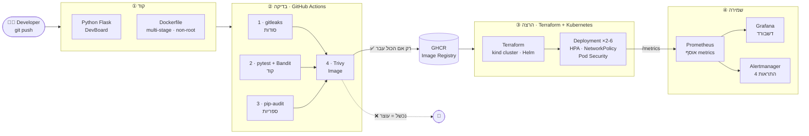

# 🚢 SecureShip: מסוע מאובטח מהקוד ועד Production

**פרויקט סיום, DevSecOps22** · בנימין שור & יוסף שוורץ

> **במשפט אחד:** בנינו מסוע שלוקח קוד של מפתח, בודק שהוא בטוח, מעלה אותו ל-Kubernetes ושומר עליו. אם משהו לא בטוח, המסוע עוצר.

---

## 4 התחנות



| תחנה | מה יש בה | מציג |
|---|---|---|
| **① קוד** | אפליקציית Flask עם metrics, ‏Dockerfile מוקשח | בנימין |
| **② בדיקה** | ‏GitHub Actions עם 4 שערי אבטחה, ופרסום ל-GHCR | בנימין |
| **③ הרצה** | ‏Terraform מקים Cluster ו-Monitoring, ‏K8s מריץ עם HPA ו-NetworkPolicy | יוסף |
| **④ שמירה** | ‏Prometheus, ‏Grafana, ‏Alertmanager | יוסף |

📘 **הסבר מפורט לכל רכיב:** [docs/components.md](docs/components.md)
🎬 **תסריט הדמו:** [docs/demo-script.md](docs/demo-script.md)
❓ **שאלות צפויות ותשובות:** [docs/qa.md](docs/qa.md)

---

## מה נלמד בקורס ואיפה הוא בפרויקט

| נושא בקורס | איפה בפרויקט |
|---|---|
| Python (Flask, REST, Layered Architecture) | `app/devboard/`, ‏`scripts/load_test.py`, ‏`monitoring/build_dashboard.py` |
| Linux | non-root user, ‏capabilities, ‏read-only filesystem, ‏Bash scripts |
| Docker | `app/Dockerfile` (multi-stage, hardened) |
| Git / GitHub | branches, ‏Pull Requests, ‏GHCR |
| CI/CD | `.github/workflows/secure-ci.yml` |
| Terraform | `terraform/` (kind + Helm providers) |
| Kubernetes (CKA) | `k8s/`: ‏Deployment, ‏Service, ‏HPA, ‏NetworkPolicy, ‏ServiceAccount, ‏Pod Security, ‏Probes |
| Networking | NetworkPolicy (default deny), ‏NodePort, ‏DNS |
| Monitoring | ServiceMonitor, ‏PrometheusRule, ‏Grafana dashboard-as-code |
| DevSecOps practices | gitleaks, ‏Bandit, ‏pip-audit, ‏Trivy, ‏least privilege |

---

## הרצה מאפס

**דרישות:** ‏Docker Desktop, ‏Terraform, ‏kind, ‏kubectl, ‏Python 3. מומלץ לתת ל-Docker לפחות 8GB זיכרון.

```bash
./scripts/up.sh
```

הפקודה מבצעת:
1. ‏`terraform apply`: ‏Cluster עם 3 nodes, ‏metrics-server, ו-Prometheus/Grafana. לוקח בערך 10–15 דקות בפעם הראשונה, בעיקר הורדת Images.
2. ‏`deploy.sh`: בונה את האפליקציה ופורס אותה.

| מה | כתובת |
|---|---|
| האפליקציה | http://localhost:8080 |
| Grafana | http://localhost:3000 ‏(user: `admin`, ‏password: `secureship`, סביבה מקומית בלבד), דשבורד **SecureShip - DevBoard** |
| Prometheus | http://localhost:9090 |
| Alertmanager | http://localhost:9093 |

### פקודות שימושיות
```bash
export KUBECONFIG=$PWD/terraform/kubeconfig
kubectl -n secureship get pods,hpa,svc        # מצב האפליקציה
./scripts/deploy.sh                           # פריסה של הקוד המקומי
./scripts/deploy.sh <git-sha>                 # פריסה של Image שעבר את ה-CI (מ-GHCR)
python scripts/load_test.py --seconds 120     # עומס, ה-HPA יגדיל Pods
./scripts/down.sh                             # מחיקת הכול
```

---

## מבנה התיקיות

```
secureship/
├── app/                        ① קוד
│   ├── devboard/               Flask: routes, store, metrics, templates
│   ├── tests/                  pytest
│   ├── Dockerfile              multi-stage, non-root, ללא pip
│   └── requirements.txt
├── .github/workflows/
│   └── secure-ci.yml           ② 4 שערי אבטחה + פרסום ל-GHCR
├── terraform/                  ③ kind cluster + metrics-server + monitoring
├── k8s/                        ③+④ כל אובייקטי Kubernetes + התראות + דשבורד
├── monitoring/                 ④ מחולל הדשבורד (Python)
├── scripts/                    up / deploy / down / load_test
└── docs/                       הסברים, תסריט דמו, שאלות ותשובות
```

---

## ממצאי אבטחה אמיתיים שה-Pipeline מצא בפרויקט

| כלי | מה נמצא | מה עשינו |
|---|---|---|
| pip-audit | ‏Flask 3.1.2: ‏PYSEC-2026-2151 | עדכון ל-Flask 3.1.3 |
| gitleaks | מפתח AWS **מזויף** שכתבנו כדוגמה בתוך קובץ התיעוד, בפוש הראשון | הוצאנו אותו מהתיעוד (נוצר רק בזמן דמו), והמופע בהיסטוריה סומן כ-false positive ב-`.gitleaksignore` |
| Trivy | 4 חולשות HIGH ב-pip ‏(msgpack, ‏urllib3) וב-setuptools בתוך ה-Image | הסרת pip/setuptools מה-Image הסופי. הסריקה עברה מ-4 ל-0 |
